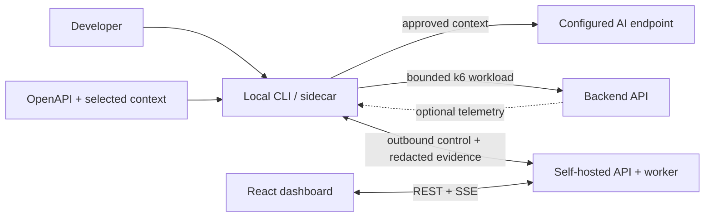

# ScaleProof

Status: Informative — early development; the plugin-first architecture is Proposed.

**Reproducible backend API experiments, with evidence you can inspect.**

ScaleProof is a self-hosted performance testing and analysis tool for backend developers. Its proposed workflow combines a local CLI/sidecar, bounded k6 workloads, optional AI scenario generation, and a React dashboard for reviewing results and investigating bottlenecks.

**Current state:** this repository contains design specifications, draft JSON Schemas, and eight .NET scaffolding projects. The CLI, dashboard, execution workflow, and AI integration are not implemented yet. See the [roadmap](docs/delivery/roadmap-and-quality.md) for delivery stages and acceptance gates.

## What ScaleProof is designed to do

- Validate scenarios, approved destinations, authentication references, and workload limits before sending test traffic.
- Run controlled HTTP workloads beside your backend and record latency, throughput, errors, sample counts, and load-generator health.
- Turn retained evidence into deterministic findings and versioned JSON/Markdown reports.
- Correlate optional OpenTelemetry evidence to investigate database, dependency, and resource behavior.
- Compare compatible baseline and candidate runs in a later milestone.

The initial scope is **explicitly approved, read-only HTTP backend APIs**. The React application is the dashboard. Browser automation, page rendering, frontend pixels, visual regression, and Core Web Vitals are outside the product's scope.

## Proposed workflow

The plugin is a separately installed `scaleproof` executable running beside your application. It works as a CLI or persistent sidecar; it is independent of your backend framework.



1. Enroll the local agent and approve the target and eligible operations.
2. Author a scenario manually, or import a local OpenAPI contract and ask AI for a draft using your goals and test-data references.
3. Review and validate the exact scenario revision, then publish it.
4. Start a separate run from the CLI or dashboard; k6 sends traffic locally to the approved backend.
5. Inspect the server's deterministic report, evidence coverage, and optional AI explanation.

The server worker owns orchestration, deterministic analysis, and report finalization. The agent enforces local execution policy and uploads bounded, redacted evidence. See the [architecture overview](docs/architecture/overview.md) for component responsibilities.

## AI assistance

The proposed AI integration runs on the developer's machine using a configured compatible API endpoint, model, and local API-key environment variable. Configuration names and budgets live in the [configuration reference](docs/specs/configuration.md#local-ai-options--proposed-adr-023).

AI can draft declarative scenarios and explain selected measured evidence. You review disclosure and generated output before publication; publishing a scenario does not start a test. Manual scenarios and deterministic reports remain usable without an AI key.

AI explanations are separate from measured outcomes. Slow HTTP responses can identify an endpoint worth investigating; attributing them to a database, dependency, or CPU bottleneck requires corresponding telemetry. Missing evidence and uncertain hypotheses stay explicit.

See the [AI assistance specification](docs/specs/ai-assistance.md) for consent, validation, credential handling, and failure behavior.

## Working with this repository

Start with the [design guide](docs/README.md). The existing solution can be built with the SDK pinned in [global.json](global.json):

```bash
dotnet build ScaleProof.sln
```

See [source architecture and implementation status](src/README.md) for the project boundaries and remaining runtime gaps. This builds the scaffolding, not the proposed end-to-end product. Installation, Compose, CLI, and frontend commands in the [local development guide](docs/engineering/local-development.md) are marked as planned until their implementations and verification exist.

| Resource | Purpose |
|---|---|
| [Product requirements](docs/product/product-requirements.md) | Audience, scope, and stable requirement IDs |
| [Implementation blueprint](docs/architecture/implementation-blueprint.md) | Project boundaries, technology choices, and safety invariants |
| [Roadmap](docs/delivery/roadmap-and-quality.md) | Ordered delivery stages and release gates |
| [Scenario contract](docs/specs/scenario-v1.md) | Declarative workloads and validation rules |
| [Testing strategy](docs/engineering/testing-strategy.md) | Planned verification and acceptance coverage |
| [Agent instructions](AGENTS.md) | Repository rules for coding agents |

The plugin-first delivery model and local AI integration are recorded in [ADR-022](docs/decisions/ADR-022-plugin-first-delivery.md) and [ADR-023](docs/decisions/ADR-023-local-ai-assistance.md). They remain Proposed; Accepted ADRs retain precedence until maintainer acceptance of the replacements.

## Contributing and license

Read [CONTRIBUTING.md](CONTRIBUTING.md), the [Code of Conduct](CODE_OF_CONDUCT.md), and [engineering standards](docs/engineering/standards.md) before making changes. Use [SECURITY.md](SECURITY.md) for security-reporting guidance.

ScaleProof is licensed under [Apache-2.0](LICENSE); see [NOTICE](NOTICE). k6 is licensed separately under AGPL-3.0 and is invoked as a separate, unmodified process.
