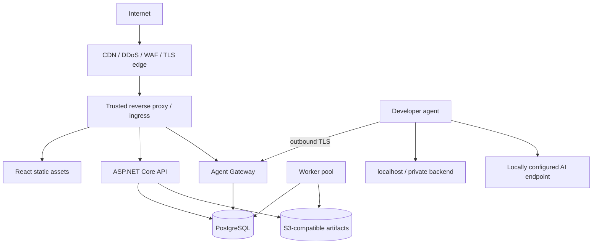

# Deployment architecture

Status: Proposed (ADR-022, ADR-023). Remote topology is required before the M0 remote-access gate; see [roadmap](../delivery/roadmap-and-quality.md).
Audience: operators, platform engineers

## Production topology

ScaleProof's React UI is deployed, but the systems it tests are backend services only. Static assets may be served by the edge/object store or a small web container. API and `/events` remain same-origin to simplify cookies and antiforgery.

## Required protection layers

### 1. Edge layer

Use a managed CDN/DDoS/WAF or equivalent ingress for TLS, known-host enforcement, connection/body limits, coarse IP reputation/rate limits, and static caching. Do not treat application rate limiting as volumetric DDoS protection.

Only the configured proxy is trusted for forwarded headers. ASP.NET Core configures explicit `KnownProxies`/`KnownNetworks`, forward count, and allowed hosts. Direct public access to Kestrel is denied by network policy.

### 2. API rate limiting

Use ASP.NET Core partitioned rate limiting after trusted forwarded headers and authentication:

| Policy | Partition | Behavior |
|---|---|---|
| Anonymous/auth endpoints | verified client IP plus endpoint class | Tight token bucket; no queue; `429` with `Retry-After` |
| Authenticated reads | actor/project | Moderate token bucket plus concurrency cap |
| Commands | actor/project and command class | Low fixed/sliding window; no automatic command queue in HTTP middleware |
| Run submissions | project | Very low rate; durable quota/admission check also required |
| Artifact upload/download | project/agent | Concurrent streams, bytes, object count, and total quota |
| SSE | actor/project | Active connection cap and maximum lifetime/heartbeat policy |
| Agent enrollment | actor/project and IP | Strict attempts, expiry, and lockout/audit |
| Agent gateway | authenticated agent ID | Connection, messages/second, bytes, and concurrent job limits |

In-memory middleware limits protect each API instance and fast paths. They do not enforce global billing/safety quotas. Durable PostgreSQL admission counters/leases enforce project-wide active runs, queued runs, daily run count, workload budget, artifact bytes, agent count, and mutation approvals atomically.

Do not partition on arbitrary user input. Emit bounded rate-limit metrics and structured rejection reasons. Health endpoints get a separate edge-only policy; they are not globally exempt.

Initial defaults for every control above are versioned configuration and are validated under load. They are listed in exactly one place: [configuration reference](../specs/configuration.md#default-api-rate-limits-per-instance-aspnet-core-partitioned-limiters).

### 3. Queue and execution back-pressure

- Bound total queued runs per project and globally.
- Bound active runs per project, worker, agent, target profile, and physical host.
- Reserve capacity for cancellation/control messages.
- Reject with a stable quota Problem Details code instead of accumulating an unbounded queue.
- The worker guards dispatch admission and the local agent enforces signed workload caps even if upstream limits fail.
- Circuit-break dispatch to an unhealthy agent/target and require recovery criteria before new runs.

### 4. Identity and authorization

Deployed mode requires OIDC, secure server-side session cookies, antiforgery on mutations, project RBAC, and audited privileged changes. Agent identity uses separate mTLS device credentials. Service-to-service identities and least-privilege database/storage credentials are distinct from user identity.

### 5. Network and egress

API containers have no need to access arbitrary targets. Only local agents receive approved target egress in the initial release. The server worker and gateway receive no workload target egress. The AI endpoint is an independently configured agent destination with local disclosure consent; it cannot be supplied by a run or remote job. Apply network policies, DNS controls, destination validation, redirect checks, and cloud-metadata denial. The agent gateway cannot use an agent as a generic proxy.

### 6. Data and secrets

Production artifacts use S3-compatible object storage with encryption, versioned retention, signed internal upload grants, and project authorization. Local development may use the filesystem adapter. Secrets reside in the platform secret manager and are referenced by ID; encryption keys and agent signing keys rotate and are never stored in scenarios.

### 7. Availability and recovery

- PostgreSQL uses automated backups, point-in-time recovery, migration backups, and restore drills.
- Object storage uses lifecycle/retention rules and integrity hashes.
- API/worker/gateway instances are disposable; durable state does not live only in memory.
- Use readiness, graceful shutdown, lease expiry, and idempotent restart behavior.
- Define RPO/RTO before production launch; do not invent numerical promises in code.

## Deployment units

| Unit | Scale dimension | Notes |
|---|---|---|
| Web assets | CDN requests | Immutable hashed assets; no secrets in build-time environment |
| API | control-plane request/concurrency | Stateless except secure session backing and caches |
| Agent Gateway | active connections/messages | Separate scaling because connections are long-lived |
| Worker | dispatch and deterministic analysis concurrency | Owns leases and finalization; no initial target traffic or k6 |
| PostgreSQL | transactions/queue state | Source of truth and durable quota/lease authority |
| Object storage | artifact bytes/requests | Direct grants only after authorization and size policy |
| OTel collector | telemetry volume | Not on correctness path for run state |

The Agent Gateway may begin inside the API deployment behind a dedicated route, but its code boundary, limits, and metrics are separate. Split it into a deployment when connection scale or failure isolation demands it; protocol semantics do not change.

## Environment model

- `Development`: local Compose, filesystem artifacts, local-mode identity, loopback targets.
- `Test`: ephemeral full stack, synthetic targets, isolated PostgreSQL/object store, no production credentials.
- `Staging`: production topology and identity with non-production targets and quotas.
- `Production`: WAF/edge, OIDC, mTLS agents, object storage, backups, alerting, and change-controlled migrations.

Configuration is environment-specific but schemas and behavior are identical. Feature flags cannot bypass target safety, authorization, redaction, or hard workload caps.

## Plugin-first deployment gate — Proposed (ADR-022, ADR-023)

Self-hosted remote deployment requires OIDC, project RBAC, TLS/proxy controls, separate agent mTLS identity/revocation, signed-manifest/start fencing, quotas, bounded artifact uploads, retention/deletion, and tested cancellation/stop bounds. Do not expose local-mode cookie APIs beyond loopback. The roadmap owns the gate and evidence checklist; security is not deferred to M2.

Install `scaleproof` on the host/network beside the target. In containers, `localhost` means the agent container, not the developer host; configure an explicit approved bridge/service origin rather than silently rewriting target policy. Agent control needs outbound connectivity only. Optional Collector/agent ingestion binds to authenticated loopback; do not publish these ports externally.

AI endpoint/model/key are set on the developer machine only. They are absent from server/container image build arguments, React variables, object storage, and k6/Collector environments. Inference connectivity failure affects only AI capability; run/report readiness stays independent. Development may use filesystem artifacts; the remotely accessible deployment uses scoped production object storage and authorization.
