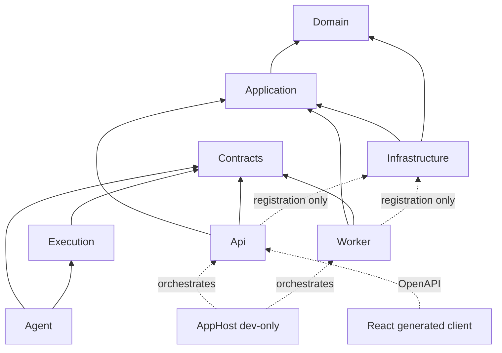

# Implementation blueprint

Status: Proposed (ADR-022, ADR-023). Existing Accepted ADR invariants remain binding; this is the target design, not implemented behavior.
Audience: implementers and coding agents; read together with [AGENTS.md](../../AGENTS.md)
Related: [overview](overview.md) · [specs](../../AGENTS.md#specifications-normative-implement-from-these) · [standards](../engineering/standards.md)

## Product shape

Proposed (ADR-022, ADR-023): ScaleProof has three runtime surfaces:

1. The separately distributed `scaleproof` CLI/sidecar (`ScaleProof.Agent`), running k6 beside the backend and optional AI inference with a locally configured key.
2. An ASP.NET Core self-hosted control plane and separate orchestrator/analyzer worker, with PostgreSQL and artifact storage.
3. A React SPA for review, explicit launch/cancel, evidence, and later comparisons.

The initial workload path is `local_agent`. Neither server API nor worker sends target traffic. The plugin is framework-independent, not an in-process SDK or arbitrary executable extension host. Use one Agent executable for commands and service mode; do not add a `ScaleProof.Cli` project. Public plugin hosting, server execution, and frontend performance testing are out of scope for the first release. See [ADR-022](../decisions/ADR-022-plugin-first-delivery.md) for the proposed partial supersession of ADR-002/009; those Accepted records are unchanged pending acceptance.

## Fixed technology choices

| Area | Choice |
|---|---|
| Backend | .NET 10 LTS, C#, ASP.NET Core Minimal APIs |
| Frontend | React 19, strict TypeScript, Vite |
| Persistence | PostgreSQL, EF Core 10, Npgsql |
| Background execution | .NET Worker Service with PostgreSQL lease-based claiming |
| Workload engine | k6 invoked only by the local agent through the shared Execution adapter (Proposed ADR-022) |
| Contracts | ASP.NET Core OpenAPI 3.1 plus repository-owned JSON Schemas |
| Frontend state | TanStack Query, React Router, React Hook Form, Zod |
| UI | CSS variables/Modules and one accessible ECharts wrapper |
| Telemetry | OpenTelemetry logs, metrics, and traces |
| Testing | xUnit v3, Testcontainers, Verify; Vitest/Testing Library/MSW/Playwright ([testing strategy](../engineering/testing-strategy.md)) |
| Local deployment | Docker Compose; Aspire AppHost for the dev loop (Proposed, [ADR-017](../decisions/ADR-017-aspire-dev-orchestration.md)) |
| Production topology | Same origin: `/` React assets, `/api` API, `/events` SSE |

Patch versions are pinned in lock/config files when bootstrapped. Framework substitutions require a superseding ADR.

## Repository layout

```text
ScaleProof/
├── ScaleProof.sln
├── global.json
├── Directory.Build.props
├── Directory.Packages.props
├── package.json
├── pnpm-lock.yaml
├── docs/
├── schemas/
│   ├── scenario/v1.schema.json
│   ├── report/v1.schema.json
│   ├── check-result/v1.schema.json
│   └── agent-protocol/v1.schema.json   # planned M0, Proposed ADR-018/022
├── src/
│   ├── ScaleProof.Domain/
│   ├── ScaleProof.Application/
│   ├── ScaleProof.Contracts/
│   ├── ScaleProof.Execution/
│   ├── ScaleProof.Infrastructure/
│   ├── ScaleProof.Api/
│   ├── ScaleProof.Worker/
│   ├── ScaleProof.Agent/
│   └── ScaleProof.AppHost/      # dev-only, Proposed (ADR-017)
├── web/scaleproof-web/
├── tests/
│   ├── ScaleProof.UnitTests/
│   ├── ScaleProof.IntegrationTests/
│   ├── ScaleProof.ContractTests/
│   ├── ScaleProof.EndToEndTests/
│   └── fixtures/
├── sample/ScaleProof.SampleApi/
├── scenarios/
├── artifacts/                  # ignored runtime output
└── compose.yaml
```

Do not create a project for every feature or interface. These eight .NET projects are the physical boundaries; organize code within them by feature. The only proposed additions are the dev-only `ScaleProof.AppHost` (plus optional `ScaleProof.ServiceDefaults`) from [ADR-017](../decisions/ADR-017-aspire-dev-orchestration.md); CLI commands live in `ScaleProof.Agent` (Proposed ADR-022).

## Dependency rules



Arrows point from the dependent project to its dependency. `Agent` never references `Api`, `Application`, `Infrastructure`, or EF Core.

- `Domain` depends only on the .NET base library.
- `Application` depends on `Domain`; it owns use cases and ports, not EF Core or HTTP.
- `Contracts` contains public DTOs/events and serialization metadata, never entities or business rules.
- `Execution` contains the engine abstraction, manifest/effective-policy enforcement, k6 process runner, normalization, redaction, and bounded artifact preparation. It has no database, web host, or user authorization code.
- `Infrastructure` implements server ports for EF Core, PostgreSQL, filesystem/S3 artifact stores, signing, and telemetry. The k6 adapter belongs to `Execution`; initial orchestration does not launch it server-side.
- `Api` owns HTTP mapping, boundary validation, authorization, OpenAPI, errors, and composition.
- `Worker` is a second composition root and never references `Api`. It owns leases, agent dispatch orchestration, deterministic analysis, and finalization. Initial workers reference Application, Contracts, and Infrastructure for registration; they do not reference Execution or launch k6 (Proposed ADR-022).
- `Agent` is independently distributed and composes `Contracts` plus `Execution` with its local target policy, control tunnel, credential store, and uploads. It never references `Api`, `Application`, `Infrastructure`, EF Core, or server persistence.
- Local telemetry uses a pinned OpenTelemetry Collector process/container with generated loopback-only configuration, or an explicitly configured existing collector. The agent does not implement a new telemetry protocol. The selected Collector exports a filtered OTLP stream to an authenticated loopback agent receiver; it is not queried as a telemetry database.
- API/Worker may reference Infrastructure for registration only; feature logic targets application interfaces.
- React consumes only published HTTP/SSE contracts.
- Proposed (ADR-023): AI transport, local context/consent, and command handlers live in Agent feature modules. They use Contracts DTOs and the shared validation boundary; they do not reference Application/Infrastructure or add inference to Execution. Server review/publication and deterministic evaluation stay in Application. No new project or provider SDK is required.

Architecture tests (ArchUnitNET or NetArchTest) enforce project and namespace dependencies.

## Domain modules

| Module | Owns |
|---|---|
| Projects | Project identity and settings |
| Targets | Versioned profiles and environment classification |
| Scenarios | Definitions, canonicalization, hashes, validation |
| Policies | Effective execution/capture limits and approvals |
| Runs | Submission, lifecycle, attempts, leases, quality, cancellation |
| Evidence | Normalized measurements and artifact metadata |
| Checks | Definitions and evidence-bearing results |
| Comparisons | Compatibility, deltas, and policy outcomes |
| Audit | Immutable security and operational events |
| Agents | Enrollment, capabilities, sessions, target rules, and revocation |

Use one PostgreSQL database and one EF Core context for M0–M2. Modules communicate through application use cases and IDs, not cross-module navigation graphs.

## Consistency model

- Submission atomically writes the immutable run snapshot, queue eligibility, and audit event.
- Claim/renew/finalize uses conditional SQL with attempt ID, lease token, and affected-row checks.
- Database records and files do not share a transaction: stream to a temp file, hash and atomically rename, then commit metadata; cleanup removes orphans.
- Production uses the same artifact-store contract with S3-compatible storage; filesystem storage is development-only.
- Completed run facts are append-only. Corrections create new attempts, comparisons, or report artifacts.
- API retries use submission IDs and database uniqueness, not in-memory deduplication.
- Do not add generic repository/unit-of-work wrappers over EF Core. Ports represent meaningful operations.

## Non-negotiable invariants

1. No target traffic occurs before schema, authorization, destination, and effective-limit validation succeeds.
2. The local executor independently revalidates policy; the worker also validates dispatch and evidence admission (Proposed ADR-022).
3. Only the current server worker lease owner can advance/finalize an attempt; agent messages are fenced evidence, never authoritative transitions (Proposed ADR-022).
4. Samples from different attempts are never combined.
5. Missing evidence is never represented as zero or pass.
6. Compatibility precedes a regression verdict.
7. Secrets/content are redacted before persistence, not only at rendering.
8. Mutation attempts are never automatically replayed after traffic may have been sent.
9. Completed snapshots, metrics, findings, and reports are immutable.
10. Every external schema has an explicit version and golden fixture.
11. A local agent accepts only signed, expiring, non-replayable manifests inside a user-approved target rule.
12. Diagnostic-tunnel observations cannot be used as capacity or latency evidence.
13. Proposed (ADR-023): model output cannot start traffic, approve disclosure, change policy, or determine quality/outcome. AI secrets never enter child-process environments or uploads.

## Agent implementation workflow

Build vertical slices in this order: schema/contracts, domain behavior, application handler, persistence/adapter, API endpoint, generated frontend types, React feature, and tests. A slice is incomplete when only one side exists.

Before finishing, update affected specifications, generate/diff OpenAPI and schemas, run relevant backend/frontend/contract/E2E tests, verify authorization/cancellation/idempotency/redaction, and avoid unrelated abstractions or dependencies.
