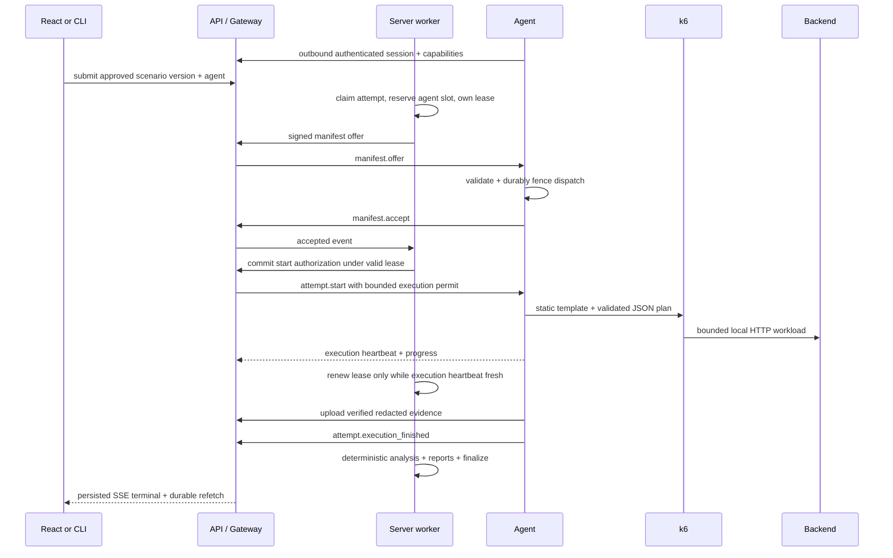

# Local agent and tunnel architecture

Status: Proposed (ADR-022, ADR-023); preserves Accepted ADR-012's outbound-only local execution constraint. Signing and wire encoding remain Proposed (ADR-014, ADR-018).
Audience: agent, gateway, worker, and security implementers
Related: [lifecycle](../specs/run-lifecycle.md), [protocol](../specs/events-and-agent-protocol.md), [AI assistance](../specs/ai-assistance.md), [configuration](../specs/configuration.md)

## Decision summary

Distribute `ScaleProof.Agent` as `scaleproof`, a framework-independent executable beside a backend API. Command mode imports contracts, reviews local disclosure, generates drafts, publishes reviewed versions, submits runs, waits, cancels, and exports reports. Service mode enrolls, connects outbound, receives bounded instructions, runs k6 locally, and uploads redacted evidence. There is no additional CLI project or SDK loaded into the backend.

The self-hosted server may be remote; it never addresses the developer's loopback interface. React is a dashboard, not a performance-test target. Initial workloads use explicitly confirmed read-only HTTP operations. Server execution, writes/stateful journeys, fleets, and diagnostic tunnels are deferred.

## Topology

The worker retains the lease through collecting/analyzing. Agent completion means execution finished, not that the run passed or became terminal. Exact guards and retry timing are owned by the lifecycle spec.

## Enrollment and identity

An authenticated project Maintainer/Owner creates a single-use enrollment code; only its hash is stored server-side. The agent generates its private key locally and exchanges the code and public key over TLS. The issued mTLS identity is bound to agent/project/key, with renewal and revocation. Keep keys in the OS credential store or a permission-restricted file. Revocation closes sessions and prevents credential renewal; a new enrollment creates a new identity.

Use a loopback local-session user identity for Stage A and OIDC/project RBAC before remote access. Agent identity is always separate from browser/user credentials. CLI publication/submission uses its enrolled project identity with narrowly granted command scopes; the API rejects user-administration operations from agent credentials. Record the approving user when a user requests work remotely and the agent identity when local commands act. No broad user token or AI key is uploaded.

## Local target policy

Approve exact scheme, host/address scope, port, base path, selected read-only operations, and hard caps locally. Defaults allow loopback only. LAN/container bridge targets require an explicit rule. A server rule cannot expand a locally stored rule; changes require a new local approval/version.

Resolve/pin destinations and revalidate redirects; deny metadata/link-local destinations, control-plane/inference/agent/Collector endpoints, unsupported schemes, path escapes, and unrelated local services. GET/HEAD/OPTIONS are eligible only after explicit non-mutation confirmation; exclude known action endpoints even if incorrectly labeled GET. Non-eligible methods fail initial-release admission.

The agent never receives a shell command, executable path, arbitrary environment variable, filesystem path, provider URL override, or generic network proxy instruction. k6 receives a static template plus validated plan, with bounded process resources and a sanitized environment.

## Control, execution, and evidence

Use outbound mTLS WebSocket with the versioned protocol. Persist message IDs, acknowledgments, accepted nonce/attempt identity, start authorization, and finished status in a permission-restricted local journal. Duplicates re-acknowledge the original result; they never rerun the engine. Restart never resumes a previously started workload automatically.

Execution requires both a verified manifest and a worker-issued start authorization committed under the current attempt lease. Renewable execution permits are bounded by that lease and the signed execution deadline. The agent stops new work when permits/control grace expire, cancels the process tree within the stop budget, and retains partial evidence. Reconnect does not renew a stale attempt. A worker may retry only after the previous executor is confirmed stopped or its bounded stop deadline has elapsed.

Only size/hash/schema-verified normalized evidence is admitted for analysis. Preserve attempt and request/window identities, units, generator health, sample counts, redaction/version metadata, and artifact hashes. Upload grants bind project, agent, run, attempt, artifact ID, size, hash, and expiry. Their destination must match the locally approved control-plane/artifact-service origins; they are not arbitrary agent egress instructions. Retries reuse the same artifact ID/hash. Late uploads from expired attempts cannot advance a run. No secret values or unrelated host files enter the transfer.

The worker alone calculates quality, thresholds, deterministic findings, and reports. An agent-supplied quality/outcome is rejected as non-authoritative. A stale worker cannot authorize starts, renew permits, admit artifacts, or finalize.

## Local telemetry and resource evidence

Telemetry is optional; HTTP-only observations remain useful. Select either a pinned agent-managed OpenTelemetry Collector or an explicitly configured existing Collector. Both must be configured to **export** a filtered OTLP stream to a bounded authenticated loopback receiver owned by the agent; a Collector is not queried as a database. See the [Collector architecture](https://opentelemetry.io/docs/collector/architecture/).

The agent creates a per-session ingestion token and a generated allow-listed pipeline: OTLP receiver → memory/attribute/redaction filters → bounded batching → agent OTLP export. Keep receiver binding and the ingestion token local; never inherit the AI key. Configure existing collectors explicitly; do not discover or rewrite unrelated collector configuration. Stop accepting telemetry when the capture window closes and drain only within the bounded collection deadline.

k6 adds non-secret run/attempt/request correlation headers. Backend test instrumentation attaches them to server spans; record clock offset/uncertainty and sampling/coverage. Accept only selected service identity, run/attempt/request scope, and declared capture window. Metrics without request correlation are labeled time-correlated observations, not request-level causation. Filter raw SQL parameters, HTTP bodies, tokens, and unrelated attributes before local persistence/export.

Target CPU/memory/GC/container measurements require exact PID/container selection and an approved metric set. Agent/k6 resource evidence is always collected where supported to detect generator saturation. Do not collect other processes, environment variables, process arguments, arbitrary logs, or system files. Record instrumentation overhead and distinguish generator saturation from target saturation.

Missing telemetry is unavailable with a reason; dependent checks become inconclusive/not applicable according to the check contract. A high HTTP p95 alone cannot identify a database or CPU root cause.

## Optional diagnostic HTTP tunnel

Deferred to M3+. No initial-release tunnel route or protocol is enabled. If later specified, it must be opt-in, single-run/origin scoped, authenticated, expiring, bounded, and independently enforced at both ends. Tunnel measurements remain ineligible for latency/capacity baselines under Accepted ADR-012.

## Failure handling

| Failure | Behavior |
|---|---|
| Agent offline/busy/revoked at submission | Reject; no server fallback |
| Worker or session lost during execution | Permit/control-grace expiry stops local traffic; fence any retry until the stop deadline |
| Duplicate offer/start or agent restart | Durable journal prevents engine replay |
| Upload interrupted | Retry by artifact ID/hash while the attempt remains authorized |
| Lease or project mismatch | Reject progress, grants, uploads, and finalization |
| AI unavailable or job interrupted | Fail only the AI job; manual execution/results remain usable |
| Protocol/engine incompatible | Reject before workload traffic |

Track dispatch delay, permit expiry, stop acknowledgment, lease loss, reconnect/replay rejection, uploads, telemetry drops, AI failures, and versions with bounded metric labels. Put run/attempt/agent IDs in logs/traces rather than aggregate labels.
