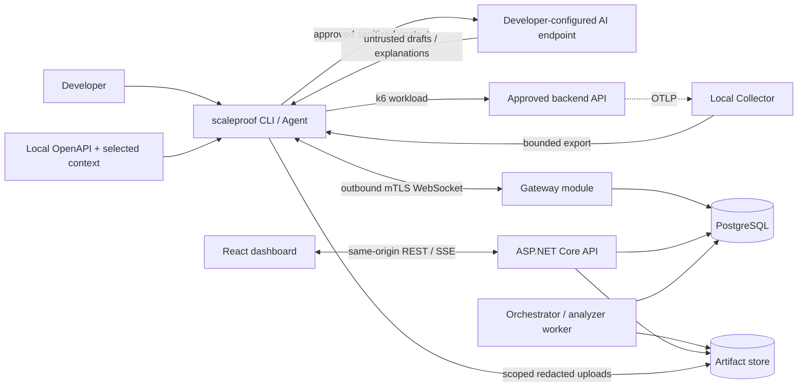

# Architecture overview

Status: Proposed (ADR-022, ADR-023). Existing Accepted ADR invariants remain binding.
Audience: everyone
Related: [blueprint](implementation-blueprint.md), [requirements](../product/product-requirements.md), [local agent](local-agent-and-tunnel.md), [AI assistance](../specs/ai-assistance.md)

## Context

ScaleProof helps backend developers run reproducible, bounded HTTP API experiments and investigate measured bottlenecks. The installed plugin is a separate CLI/sidecar, not code loaded into the target. The React application is a self-hosted control and evidence dashboard; it never tests frontend pixels, pages, rendering, or browser performance.

The gateway starts inside the API. PostgreSQL remains the durable queue, lease, and quota authority. No broker, standalone AI service, separate CLI project, or plugin marketplace is introduced. Production artifacts use the existing S3 adapter contract; development may use the filesystem adapter.

## Module ownership

| Module | Owns | Must not own |
|---|---|---|
| React | Scenario review, submission/cancel, status, evidence visualization | AI keys, target traffic, authoritative policy |
| Agent command mode | Local import, disclosure review, AI calls, draft publication, API automation | Server database or independent verdict logic |
| Agent service mode | Enrollment/session, manifest validation, local enforcement, k6, normalization/redaction/uploads | Arbitrary remote commands, model tools, project finalization |
| API | Identity/authz, boundary validation, admission, published versions, reads/SSE | Inference keys, target traffic, long-running execution |
| Gateway | Authenticated messages, durable dispatch/ack fencing, upload authorization | Owning attempt leases or changing run outcomes from agent claims |
| Worker | Attempt lease, dispatch orchestration, deterministic quality/checks/reports, finalization and sweeps | Target-facing execution or model-dependent verdicts |
| Execution adapter | Static k6 template/plan, caps, process supervision, normalized evidence | Database, user authorization, AI generation |
| AI feature modules | Bounded local requests, untrusted output validation, reviewed publication | Workload authority or deterministic business rules |

## End-to-end flow

1. Developer enrolls the agent and locally approves the exact target rule. Manual scenarios work without AI.
2. Optional AI import selects OpenAPI operations and goals; a local preview grants disclosure consent. AI produces a draft with explicit questions/assumptions.
3. A reviewed revision passes server validation and becomes an immutable scenario version. Publication sends no workload traffic.
4. CLI or dashboard separately submits a run with scenario/target/policy versions and an online agent. API authorizes and reserves quotas atomically.
5. Worker claims an attempt and gateway relays its signed manifest. Agent verifies identity, expiry, nonce, versions, local rule, limits, and dispatch fencing.
6. A durable accept/start handshake authorizes one execution. Agent runs k6 beside the backend, captures generator health, and exports bounded evidence. Server processes never access the target.
7. Optional telemetry is correlated to run/attempt/request identities and filtered/redacted before upload. It does not control workload execution.
8. Worker verifies committed evidence, evaluates deterministic checks/thresholds/quality, writes immutable reports, and finalizes under its lease. Browser sees persisted state through SSE and refetch.
9. Optional AI explanation uses an explicitly approved evidence bundle and is published separately. AI absence/failure cannot rewrite the measurement.

See [lifecycle](../specs/run-lifecycle.md) for lease authority, stop deadlines, retries, and finalization. Compatibility still precedes comparison in M1. Missing evidence, generator saturation, and backend threshold failures remain distinct.

## Deployment evolution

The ordered delivery stages and remote-security gate live in [release scope](../product/product-requirements.md#release-scope) and [roadmap](../delivery/roadmap-and-quality.md). Remote access requires identity and agent controls before launch. Diagnostic tunnels, server execution, fleets, and SDKs require later specifications.
