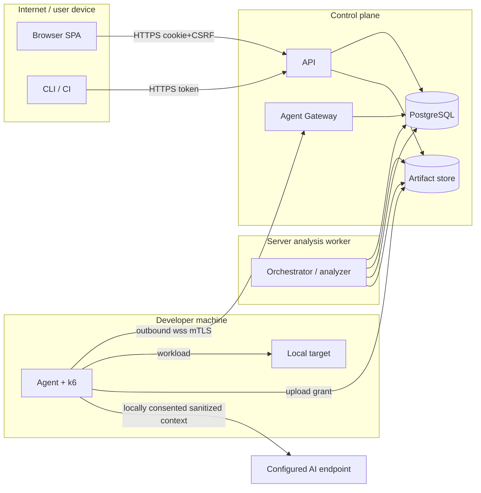

# Threat model

Status: Normative for existing threats; revised topology and T-17 onward are Proposed (ADR-022, ADR-023). Review it whenever a trust boundary changes.
Audience: security reviewers, maintainers, coding agents
Related: [security and operations](security-and-operations.md), [local agent](local-agent-and-tunnel.md), [deployment](deployment-architecture.md), NFR-003, NFR-004, NFR-011

Method: STRIDE per trust boundary. Every mitigation listed here must have an automated test (the **Test** column), or else be marked as an operational control.

## Data-flow diagram and trust boundaries

Boundaries:

- **TB1→TB2:** untrusted users and clients
- **TB2→TB3:** worker claims/leases dispatch and validates returned evidence; it sends no target traffic initially (Proposed ADR-022)
- **TB4→target:** agent workload egress, the initial SSRF surface; server target egress is disabled (Proposed ADR-022)
- **TB4↔TB2:** the agent is partially trusted. It authenticates with its own credential, and the server treats its uploads as untrusted.

## Threats and mitigations

| ID | Boundary | STRIDE | Threat | Mitigation | Test |
|---|---|---|---|---|---|
| T-01 | TB4→target | Tampering / EoP | SSRF to cloud metadata, control plane, or private ranges via host, DNS rebinding, or redirect | Resolve and pin IP, deny private/link-local/metadata ranges in remote mode, revalidate every redirect hop, deny control-plane CIDRs, network egress policy | Adversarial URL/DNS/redirect suite (US-030) |
| T-02 | TB1→TB2 | DoS (to third parties) | ScaleProof used as a DDoS tool against arbitrary targets | Remote execution disabled by default; approved target profiles; hard caps; quotas; audit | Policy + quota race tests |
| T-03 | TB1→TB2 | Spoofing | Cross-site request forgery on mutations | Antiforgery token, `SameSite=Lax`, same-origin only | Integration tests per mutation endpoint |
| T-04 | TB1→TB2 | Info disclosure | Cross-project access (IDOR) | `project_id` filter in every query; authz in handlers, not only endpoints; 404 for foreign IDs | Authorization matrix test over all routes |
| T-05 | TB2/TB4 | Info disclosure | Secrets in snapshots, logs, reports, or errors | Secret references only; literal detection; redaction before persistence; log scrubbing | Seeded-secret canary tests through every output |
| T-06 | TB2→TB4 | EoP | Code injection via scenario into the k6 script or shell | Static template plus JSON plan; `ArgumentList`; no shell; sanitized environment | Fuzzed scenario fields never alter the template hash or argv |
| T-07 | TB4 | DoS | k6 exhausts local executor resources | Process-tree limits, cgroup/container limits, output caps, wall-clock kill | Oversized/long-running fixture tests |
| T-08 | TB4↔TB2 | Spoofing | Rogue agent impersonation | mTLS device cert bound to agent/project; fingerprint check; revocation | Revoked/forged cert tests |
| T-09 | TB4↔TB2 | Tampering / EoP | Malicious gateway or MITM instructs the agent to attack other local services | Signed manifest (JWS (Proposed ADR-014), `aud`, `exp`, `jti`); agent-side local rule; agent never accepts commands or paths | Manifest tamper/replay/rule-escape tests |
| T-10 | TB4→TB2 | Tampering | Agent uploads forged or oversized evidence | Upload grants with size limit; hash verification; schema validation; evidence labeled with agent identity | Oversized/mismatched-hash upload tests |
| T-11 | TB2 | Repudiation | User denies a dangerous run or policy change | Append-only audit events with actor and mode | Audit presence tests per privileged command |
| T-12 | TB2 | Tampering | Duplicate mutation execution after a crash | No auto-retry after `traffic_started` for mutations; reconciliation state | Lease-expiry mutation test |
| T-13 | TB1→TB2 | DoS | API flood | Edge limits plus partitioned rate limits plus bounded bodies and pagination | Load test of limiter behavior |
| T-14 | Release | Tampering | Supply-chain compromise of agent binary/update | Cosign-signed artifacts; identity-pinned verification; SBOM; pinned action SHAs ([ADR-020](../decisions/ADR-020-license-and-supply-chain.md)) | Update verification test with a bad signature |
| T-15 | TB2 | Info disclosure | Artifact download renders as HTML (stored XSS) | `Content-Disposition: attachment`, `X-Content-Type-Options: nosniff`, strict CSP on SPA | Header tests |
| T-16 | TB4 | Info disclosure | Agent collects unrelated host data | Exact PID/container selection; allow-listed metric set; no env/args/files | Agent telemetry allow-list tests |

## Plugin and AI threats — Proposed (ADR-022, ADR-023)

The local agent → configured inference endpoint is a separate disclosure boundary. Only local endpoint configuration and exact-context consent authorize it; workload target rules do not authorize inference or vice versa. Treat API descriptions and AI output as adversarial data.

| ID | Boundary | STRIDE | Threat | Mitigation | Test |
|---|---|---|---|---|---|
| T-17 | Agent→AI | Info disclosure | Keys or sensitive contract/evidence content reaches unintended destination | Local endpoint/model/context preview, hash-bound consent, HTTPS/no redirects, allow-listed prompt fields, key excluded from child environments | Canary across preview, requests, child env, logs, provider errors, uploads |
| T-18 | Import/model→Agent | EoP | Prompt injection or invented scenario starts arbitrary traffic/tools | No model tools/code, catalog/schema/policy validation, operation confirmation, revision review and separate submission | Malicious descriptions/output cannot execute, expand target scope, or start a run |
| T-19 | Local import | DoS / info disclosure | External refs, YAML expansion, recursion, oversized contracts read files or fetch URLs | Local-only refs, safe parsing and depth/size bounds | File/URL ref, duplicate-key, alias bomb and cyclic-reference fixtures |
| T-20 | AI→dashboard | Tampering / EoP | Unsupported root cause, forged references, or model HTML misleads/executes | Evidence-reference validation, hypotheses/limitations, plain-text rendering, independent deterministic report | Foreign/missing evidence and XSS fixtures; report unchanged under AI outage |
| T-21 | Worker↔Agent | DoS / tampering | Lease expiry/reconnect starts overlapping tests | Durable start journal, committed permits, heartbeat checks, persisted stop bound, reserved agent slot | Dead-worker/live-gateway, duplicate start, clock rollback, crash/retry overlap tests |
| T-22 | Agent→AI / API jobs | DoS | Retry loops or unbounded inference spend | One request/job, byte/token/time/queue/daily caps, no automatic replay/fallback | 401/429/5xx, timeout, cancellation, oversized response and quota-race tests |
| T-23 | Draft→publication | Tampering | Stale review or cross-project provenance publishes unsafe scenario | ETag/revision-bound approval, scoped FKs/authz, atomic idempotent publication | Concurrent edit/publish and foreign-project agent/draft/report cases |
| T-24 | Collector→Agent | Spoofing / info disclosure | Unrelated telemetry enters a run or receiver is exposed | Authenticated loopback receiver, service/run/attempt filters, exact-process opt-in, capture bounds | Wrong token/service/attempt, buffer overflow and no-LAN-binding tests |

## Out of scope (accepted risks)

- A compromised developer machine. The agent cannot protect a host its user does not control.
- Load caused against a target that the user is legitimately authorized to test, within caps.
- Side-channel accuracy attacks on measurements. Results are evidence, not attestations.
