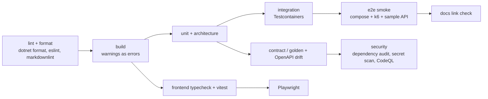

# Testing strategy

Status: Normative
Audience: all contributors and coding agents
Related: [standards](standards.md#verification-and-change-reporting) · [roadmap exit criteria](../delivery/roadmap-and-quality.md) · [threat model](../architecture/threat-model.md)

## Test projects and tools

Proposed ([ADR-024](../decisions/ADR-024-contract-test-foundation.md)): initial
contract/unit project setup, dependency pins, VSTest runner, offline schema
resolution, and the contract-only requirement coverage matrix. The proposal adds
no packages until the maintainer decision; runtime acceptance remains separate.

| Layer | Project / location | Tools | Scope |
|---|---|---|---|
| Unit | `tests/ScaleProof.UnitTests` | xUnit v3, FsCheck (property tests) | Domain rules, policy, canonicalization, hashing, state graph, statistics, percentiles, threshold evaluation, redaction, checks |
| Architecture | `tests/ScaleProof.UnitTests/Architecture` | ArchUnitNET or NetArchTest | Project and namespace dependency rules from the [blueprint](../architecture/implementation-blueprint.md#dependency-rules) |
| Integration | `tests/ScaleProof.IntegrationTests` | `WebApplicationFactory`, Testcontainers (PostgreSQL), Respawn (DB reset between tests), WireMock.Net (fake targets, DNS/redirect cases) | HTTP + DI + EF Core + migrations, lease SQL races, cancellation, authz matrix, Problem Details, rate limits, quotas, SSE resume |
| Contract / golden | `tests/ScaleProof.ContractTests`, fixtures in `tests/fixtures/` | **Verify** (snapshot), JsonSchema.Net | Scenario/report/check-result schemas, k6 NDJSON → evidence, report rendering, OpenAPI drift, agent protocol N-1 compatibility |
| End-to-end | `tests/ScaleProof.EndToEndTests` | Testcontainers or Aspire testing (`Aspire.Hosting.Testing`), real k6, sample API | Clean flow: validate → run → report; regression fixtures; N+1 fixtures |
| Frontend unit/component | `web/scaleproof-web/src/**/*.test.ts(x)` | Vitest, Testing Library, MSW, vitest-axe | Formatting, URL state, query keys, forms, route states |
| Frontend E2E | `web/scaleproof-web/e2e` | Playwright, @axe-core/playwright | Critical journeys, keyboard flow, accessibility |
| Self-load | `tests/load/` | k6 (against ScaleProof itself) | Submission bursts, SSE fan-out, worker loss |

## Golden contracts

- Fixtures live under `tests/fixtures/<contract>/<version>/`. Each has an `input`, plus a `*.verified.*` file managed by Verify.
- Fixtures are **sanitized**: no real hosts, secrets, or personal data. A CI grep check rejects common secret patterns.
- A changed `.verified.` file in a PR must be explained in the PR description. It is a contract change.

## Rules

- Run the narrowest relevant test first, then broader suites.
- Concurrency tests run every race at least 50 iterations, with a randomized delay injected at the critical points.
- Non-determinism (clock, randomness, IDs) is injected: `TimeProvider`, seeded `Random`, and an ID generator interface.
- Tests never depend on internet access. k6 binaries are pinned in CI.
- Every bug fix includes a regression test that fails without the fix.

## CI pipeline (target)

## Plugin-first acceptance matrix — Proposed (ADR-022, ADR-023)

Use synthetic OpenAPI documents, a local fake inference server, a disposable sample backend, and real PostgreSQL/k6 integration fixtures. Tests do not call paid/external inference. A separately documented, opt-in provider compatibility smoke test may verify the minimal configured profile without becoming a CI dependency.

| Behavior / requirements | Validation and expected result |
|---|---|
| FR-047, FR-031 | Same Agent executable's command/service modes complete manual validate → submit → local k6 → server report without AI configuration; CLI exit semantics unchanged |
| FR-002–FR-004, FR-048–FR-049 | Import/method/policy/limit/secret failures, external refs and invented endpoints send zero workload traffic; unresolved fixtures/SLO review blocks publication |
| FR-049, T-23 | Edit/publish races invalidate stale approval; repeated publication creates one immutable version; publication itself sends zero traffic |
| FR-016/032, T-21 | Duplicate dispatch/start, agent journal/restart, dead worker with live gateway, expired permit, clock rollback, delayed messages and old-process retry cannot produce overlapping workload execution |
| FR-012/046 | Cancellation/revocation/disconnect while running, uploading and analyzing stops within the recorded bound; stale agent/worker results are rejected |
| FR-034, NFR-003/011 | Project authorization matrix includes jobs/drafts/explanations/agents/artifacts; upload size/hash/origin, active-run and inference quota races, deletion/retention preserve fences and active references |
| FR-051, T-17/22 | Secret canaries across import, preview, model output/errors, child env and all persistence; inference requests never auto-retry after 401/429/5xx/timeout/restart |
| FR-050, T-20 | Explanation source hash/refs are valid; HTML inert; missing telemetry cannot yield asserted DB/CPU diagnosis; report bytes/outcome remain unchanged under AI failure |
| FR-018/024, T-24 | HTTP-only output marks telemetry absent; instrumented slow-dependency/repeated-query fixtures produce qualified evidence; optimized fixture avoids the finding; wrong-token/service/attempt spans are rejected |
| FR-043/045, US-043–US-046 | Dashboard waiting-for-local-consent, offline-agent, draft revision, missing-key/manual path, independent Run action, stale explanation and all route states remain keyboard-accessible |

Before runtime implementation, add versioned JSON Schemas and golden fixtures for the draft/protocol/explanation DTOs, generate OpenAPI/client code, and diff them. This design-only revision does not claim those generated artifacts or runtime tests exist.

Documentation verification checks relative file links and heading anchors, Status/ADR labels, stable requirement/story IDs, traceability references, JSON/schema examples, and contradictory milestone/ownership statements. Preserve Accepted ADR files byte-for-byte until an explicit maintainer acceptance/supersession change.
