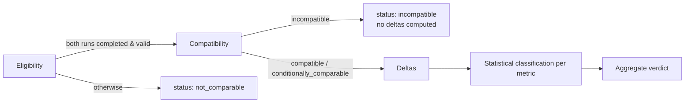

# Baseline/candidate comparison

Status: Normative for compatibility and deltas. The statistical verdict is Proposed ([ADR-016](../decisions/ADR-016-comparison-statistics.md)).
Audience: backend implementers, report consumers, CI users
Related: FR-022, FR-026, US-011–US-013, US-015, [ADR-006](../decisions/ADR-006-compatible-comparisons-only.md), [metrics](metrics-and-statistics.md)

## Order of evaluation (invariant 6)



## 1. Eligibility

Both runs must have lifecycle `completed` and `qualityStatus = valid`. If not, the result is `not_comparable` with reason `run_not_valid` or `run_not_completed`. Neither run may be `diagnostic_tunnel`.

## 2. Compatibility rules (`CompatibilityPolicy v1`)

| Dimension | Compatible | Conditionally comparable (reason recorded) | Incompatible |
|---|---|---|---|
| Scenario identity | Same scenario name and same request set and weights | Same requests, different thresholds or checks only | Different request set, weights, methods, or paths |
| Workload shape | Same profile, rate/VUs, windows | Measurement window differs ≤ 25% | Different profile or rate/VUs |
| Target profile | Same profile version or same sanitized origin | Different version with same origin and policy | Different origin or environment class |
| Execution location | Same location, same agent (agent runs) | Different agents with same OS, arch, and CPU count | Different location |
| Engine | Same k6 minor | Same major | Different major or engine |
| Dataset | Same dataset hashes | — | Different dataset hashes |
| Build/environment fingerprint | Only the candidate build differs (expected) | Runtime version patch differs | Runtime major/minor, container limits, or host class differs |
| Telemetry | Same availability | Candidate missing telemetry (telemetry checks become `inconclusive`) | — |

The outcome is the worst dimension. Every non-`compatible` dimension adds a reason `{dimension, baseline, candidate, rule}` to `compatibility.reasons[]`, and those reasons are rendered **before** any delta (US-015).

## 3. Deltas

For each metric and aggregation that is gated by thresholds, plus the default set (`http_req_duration` p50/p95/p99, `http_req_failed`, `achieved_rate`):

- `absoluteDelta = candidate − baseline`, in the metric unit
- `relativeDelta = absoluteDelta / baseline`. If the baseline is `0` or `null`, the delta is `null` with reason `zero_baseline` or `missing_baseline`. It is never `±∞`.
- `direction`: each metric declares `lower_is_better` or `higher_is_better`, and `worse` is derived from that.
- A delta on an `unstable` or `suppressed` percentile is computed but flagged, and it cannot produce `fail`.

## 4. Statistical classification (Proposed, ADR-016)

Per metric, using interval values from the measurement windows:

- **Minimum data** (`ComparisonPolicy v1`): ≥ 6 intervals per run. In `gate` mode, also ≥ 3 repetitions per side. Below that: `inconclusive` (`insufficient_samples`).
- **Tests:**
  - two-sided Mann–Whitney U with tie correction, α = 0.01
  - bootstrap 95% CI of the relative delta of the chosen aggregation, with 2,000 resamples and a seed equal to the first 8 bytes of SHA-256(comparisonId)
- **Classification** (`threshold` = metric's practical-significance threshold, default 5% for latency and 0.5 percentage points for error rate):

| Condition | Metric status |
|---|---|
| CI entirely beyond `+threshold` in the worse direction and p < α | `fail` |
| CI entirely within `[−threshold, +threshold]` | `pass` |
| CI excludes 0 in the worse direction, does not exceed threshold | `warn` |
| otherwise | `inconclusive` |

Until ADR-016 is accepted, implementations may use **fixed thresholds only**: metric status is `fail` when `relativeDelta` exceeds the threshold in the worse direction. Reports then carry `method: fixed_threshold` and the limitation "single-run comparison; noise not estimated".

## 5. Aggregate verdict and policy modes

| Mode | `fail` metric | `inconclusive` metric | CLI exit |
|---|---|---|---|
| `gate` | verdict `fail` | verdict `inconclusive` | 1 / 2 |
| `warn` | verdict `warn` | verdict `warn` | 0 |
| `report` | verdict as computed; never blocks | — | 0 |

Exit codes are defined in [error codes](error-codes.md#cli-exit-codes).

## Result shape

The comparison result is part of [report v1](report-v1.md#top-level-structure):

```json
{
  "comparisonId": "…",
  "policyVersion": "comparison/1",
  "method": "mann_whitney_bootstrap",
  "baselineRunId": "…", "candidateRunId": "…",
  "compatibility": { "status": "conditionally_comparable", "reasons": [ { "dimension": "measurementWindow", "baseline": "120000", "candidate": "150000", "rule": "window_within_25pct" } ] },
  "metrics": [
    { "metric": "http_req_duration", "aggregation": "p95", "unit": "ms", "direction": "lower_is_better",
      "baseline": 212.4, "candidate": 241.9, "absoluteDelta": 29.5, "relativeDelta": 0.139,
      "ci95": [0.081, 0.197], "pValue": 0.0004, "threshold": 0.05, "status": "fail" }
  ],
  "verdict": "fail"
}
```
