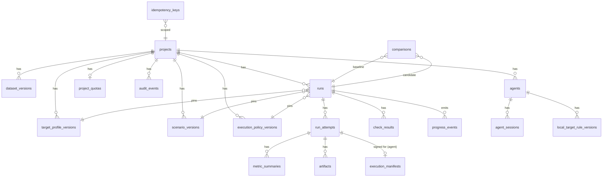

# Database schema

Status: Normative for existing invariants; plugin-first claim/fencing changes and AI records are Proposed (ADR-022, ADR-023). Column lists are indicative until the first migration; the EF Core model and migrations then become authoritative.
Audience: backend implementers, coding agents
Related: [data and contracts](../architecture/data-and-contracts.md#core-records), [run lifecycle](run-lifecycle.md), [ADR-007](../decisions/ADR-007-postgresql-leased-queue.md), [ADR-021](../decisions/ADR-021-keep-postgresql-lease-queue.md), [backend persistence](../architecture/backend-architecture.md#persistence)

## Conventions

- One database and one `ScaleProofDbContext`. Use snake_case (`EFCore.NamingConventions`).
- Keys are `uuid` (UUIDv7 generated in the application). Timestamps are `timestamptz` (UTC). Durations are `bigint` milliseconds. Byte sizes are `bigint`.
- Enums are stored as `text` with a `CHECK` constraint. Do not use PostgreSQL enum types, which are hard to migrate.
- Mutable control rows have `version integer` as the optimistic concurrency token (`xmin` is acceptable).
- JSONB holds only versioned documents that are never filtered on: the canonical scenario, the effective policy, evidence summaries, and finding evidence.
- Every project-owned table has `project_id` with a foreign key and an index, and every query filters on it (authorization, NFR-003).

## Entity relationships



## Tables

| Table | Key columns | Constraints and indexes |
|---|---|---|
| `projects` | `id`, `slug`, `name`, `owner_subject`, `is_local`, `settings jsonb`, `created_at`, `version` | `UNIQUE(slug)` |
| `target_profile_versions` | `id`, `project_id`, `name`, `version`, `environment_class`, `origin`, `allowed_base_paths text[]`, `policy jsonb`, `hash`, `created_by`, `created_at` | `UNIQUE(project_id, name, version)`; immutable (no UPDATE grant in production role) |
| `scenario_versions` | `id`, `project_id`, `name`, `version`, `schema_version`, `canonical jsonb`, `canonicalization_version`, `hash`, `created_by`, `created_at` | `UNIQUE(project_id, name, version)`; `INDEX(project_id, hash)` |
| `dataset_versions` | `id`, `project_id`, `name`, `version`, `artifact_key`, `hash`, `bytes` | `UNIQUE(project_id, name, version)` |
| `execution_policy_versions` | `id`, `project_id`, `limits jsonb`, `hash`, `created_at` | `UNIQUE(project_id, hash)` (deduplicated) |
| `runs` | `id`, `project_id`, `scenario_version_id`, `target_profile_version_id`, `policy_version_id`, `execution_location`, `agent_id null`, `lifecycle`, `quality_status null`, `outcome null`, `termination_reason null`, `cancel_reason null`, `cancel_requested_by null`, `cancel_requested_at null`, `current_attempt_ordinal`, `not_before`, `queued_at`, `started_at`, `finished_at`, `build jsonb`, `environment_fingerprint`, `repetition_group_id null`, `created_at`, `submitted_by`, `version` | `INDEX(project_id, created_at DESC, id DESC)`; **partial** `INDEX(queued_at, id) WHERE lifecycle='queued'` (claim); `INDEX(lifecycle) WHERE lifecycle IN ('validating','running','collecting','analyzing','cancelling')` (sweeps) |
| `run_attempts` | `id`, `run_id`, `ordinal`, `lifecycle`, `lease_owner`, `lease_token bytea`, `lease_expires_at`, `heartbeat_at`, `engine_version`, `started_at`, `finished_at`, `traffic_started boolean` | `UNIQUE(run_id, ordinal)`; **partial** `UNIQUE(run_id) WHERE lifecycle='active'` (at most one active lease, FR-032); `INDEX(lease_expires_at) WHERE lifecycle='active'` |
| `metric_summaries` | `attempt_id`, `metric`, `aggregation`, `window`, `request null`, `value numeric null`, `unit`, `sample_count`, `percentile_status`, `unavailable_reason`, `definition_version` | PK on all identifying columns |
| `artifacts` | `id`, `project_id`, `run_id`, `attempt_id`, `kind`, `storage_key`, `sha256`, `bytes`, `media_type`, `schema_version`, `redaction_version`, `expires_at`, `pinned` | `UNIQUE(storage_key)`; `INDEX(run_id)` |
| `check_results` | `id`, `run_id`, `attempt_id`, `check_id`, `check_version`, `status`, `severity`, `confidence`, `document jsonb` | `INDEX(run_id)` |
| `comparisons` | `id`, `project_id`, `baseline_run_id`, `candidate_run_id`, `policy_version`, `compatibility`, `verdict`, `document jsonb`, `created_at` | `INDEX(project_id, created_at DESC)` |
| `progress_events` | `run_id`, `seq bigint`, `type`, `payload jsonb`, `created_at`, `expires_at` | `PK(run_id, seq)`; `INDEX(expires_at)` |
| `idempotency_keys` | `project_id`, `actor`, `route`, `key`, `request_hash`, `response_status`, `response_body jsonb`, `resource_id`, `expires_at` | `PK(project_id, actor, route, key)` |
| `audit_events` | `id`, `project_id`, `actor`, `actor_mode`, `event`, `subject_type`, `subject_id`, `data jsonb` (no secrets), `at` | Append-only; `INDEX(project_id, at DESC)` |
| `project_quotas` | `project_id`, `max_queued`, `max_active`, `max_daily_runs`, `max_agents`, `max_artifact_bytes`, `version` | Admission reads with `FOR UPDATE` |
| `agents` (M0, Proposed ADR-022) | `id`, `project_id`, `display_name`, `cert_fingerprint`, `status`, `protocol_version`, `capabilities jsonb`, `last_seen_at`, `revoked_at` | `UNIQUE(cert_fingerprint)` |
| `agent_sessions` (M0, Proposed ADR-022) | `id`, `agent_id`, `connected_at`, `disconnected_at`, `last_ack_seq`, `last_sent_seq`, `remote jsonb` | |
| `local_target_rule_versions` (M0, Proposed ADR-022) | `id`, `agent_id`, `project_id`, `version`, `scheme`, `host`, `ip_scope cidr`, `port`, `base_path`, `allowed_operations jsonb`, `non_mutation_confirmed_by`, `non_mutation_confirmed_at`, `allow_mutation`, `created_by`, `created_at` | Immutable |
| `execution_manifests` (M0, Proposed ADR-022) | `attempt_id`, `agent_id`, `jti`, `kid`, `issued_at`, `expires_at`, `status` | `UNIQUE(jti)` |
| `enrollment_codes` (M0, Proposed ADR-022) | `code_hash`, `project_id`, `created_by`, `expires_at`, `used_at` | Store only a hash of the code |

## Lease SQL

The token/expiry guards remain normative. The local-agent claim and fencing additions are Proposed (ADR-022). Use parameterized raw SQL through EF Core (`Database.SqlQuery`) or Npgsql, and cover every statement with concurrency integration tests.

**Admission** runs in the same transaction as the run insert:

```sql
SELECT max_queued, max_active, max_daily_runs FROM project_quotas WHERE project_id = @p FOR UPDATE;
SELECT count(*) FILTER (WHERE lifecycle = 'queued')                                   AS queued,
       count(*) FILTER (WHERE lifecycle IN ('validating','running','collecting','analyzing','cancelling')) AS active,
       count(*) FILTER (WHERE queued_at >= date_trunc('day', now()))                  AS today
FROM runs WHERE project_id = @p;
-- reject with QUOTA_EXCEEDED if over; else INSERT run (lifecycle='queued'), audit_event, progress_event seq=1
```

**Claim** (Proposed ADR-022) is a short transaction per run. First lock the project quota and selected agent row in a consistent order, verify project active capacity and agent availability/compatibility/rule version, and reserve the agent slot. A unique active reservation prevents two workers claiming different runs for the same agent. Include those reservation writes and the dispatch/attempt insert in this transaction. Release the locks after commit, never while waiting for the agent. The following SQL shows the run/attempt portion; it is not sufficient without the quota/reservation checks:

```sql
WITH next AS (
  SELECT id FROM runs
  WHERE lifecycle = 'queued' AND execution_location = 'local_agent'
    AND agent_id = @reservedAgentId AND not_before <= now()
  ORDER BY queued_at, id
  FOR UPDATE SKIP LOCKED
  LIMIT 1
)
UPDATE runs r
SET lifecycle = 'validating', current_attempt_ordinal = r.current_attempt_ordinal + 1,
    started_at = coalesce(r.started_at, now()), version = r.version + 1
FROM next WHERE r.id = next.id
RETURNING r.id, r.current_attempt_ordinal;

INSERT INTO run_attempts (id, run_id, ordinal, lifecycle, lease_owner, lease_token, lease_expires_at, heartbeat_at)
VALUES (@attemptId, @runId, @ordinal, 'active', @workerId, @token, now() + @lease, now());
```

**Heartbeat:** if zero rows are affected, the lease is lost. Stop immediately.

```sql
UPDATE run_attempts SET lease_expires_at = now() + @lease, heartbeat_at = now()
WHERE id = @attemptId AND lease_token = @token AND lifecycle = 'active' AND lease_expires_at > now();
```

**Run transition by the lease owner** (e.g. running → collecting):

```sql
UPDATE runs r SET lifecycle = @to, version = r.version + 1
FROM run_attempts a
WHERE r.id = @runId AND r.lifecycle = @from
  AND a.run_id = r.id AND a.id = @attemptId AND a.lease_token = @token
  AND a.lifecycle = 'active' AND a.lease_expires_at > now();
```

**Finalize:** in one transaction, update the attempt `active → succeeded|failed|cancelled` (guarded by token and expiry as above), then update the run to its terminal lifecycle (guarded by `current_attempt_ordinal = @ordinal`). If either update affects zero rows, roll back.

**Expiry sweep** runs every `Worker:SweepInterval` (default 10 s) on any worker:

```sql
UPDATE run_attempts SET lifecycle = 'expired', finished_at = now()
WHERE lifecycle = 'active' AND lease_expires_at < now() - @grace
RETURNING run_id, ordinal, traffic_started;
-- In the same transaction, apply exactly one guarded lifecycle branch per expired row.
-- Proposed ADR-022: retain agent reservation; no retry before stopped_at or executor_stop_not_after.
-- Store not_before >= executor_stop_not_after for an unacknowledged prior execution.
-- These branches are alternatives, not statements to execute unconditionally:
UPDATE runs SET lifecycle = 'cancelled', termination_reason = 'lease_expired_during_cancel', finished_at = now(), version = version + 1
WHERE id = @runId AND lifecycle = 'cancelling' AND current_attempt_ordinal = @ordinal
  AND @previousExecutionFenced;
UPDATE runs SET lifecycle = 'queued', not_before = now() + @backoff, version = version + 1          -- retry allowed
WHERE id = @runId AND lifecycle IN ('validating','running') AND current_attempt_ordinal = @ordinal
  AND @readOnly AND @attemptsRemaining AND @previousExecutionFenced;
UPDATE runs SET lifecycle = 'failed', termination_reason = @reason, finished_at = now(), version = version + 1  -- lease_lost / reconciliation_required
WHERE id = @runId AND lifecycle IN ('validating','running','collecting','analyzing') AND current_attempt_ordinal = @ordinal;
```

**Cancellation** (API):

```sql
UPDATE runs SET lifecycle = 'cancelled', termination_reason = 'user_cancelled', finished_at = now(), version = version + 1
WHERE id = @runId AND lifecycle = 'queued';
-- if 0 rows:
UPDATE runs SET lifecycle = 'cancelling', cancel_reason = @reason, cancel_requested_by = @actor,
       cancel_requested_at = now(), version = version + 1
WHERE id = @runId AND lifecycle IN ('validating','running','collecting','analyzing');
-- if still 0 rows: already cancelling/terminal → return current state (idempotent, no audit event)
-- otherwise, in the same transaction: INSERT audit_event ('run.cancel_requested') and the progress_event for SSE.
-- @reason = 'user_cancelled' from the API; the lease owner uses the same statement with an abort_* reason and @actor = 'system'.
```

Proposed ADR-022: sweep expired attempts with outstanding reservations again until their stop bound is satisfied; marking an attempt expired must not make a still-cancelling run invisible to reconciliation. Workers learn about cancellation by checking the run lifecycle on each heartbeat. LISTEN/NOTIFY may shorten latency later, but correctness never depends on it.

## Migrations

- EF Core migrations live in `ScaleProof.Infrastructure/Persistence/Migrations`.
- Apply them with a migration bundle (`dotnet ef migrations bundle`) as a separate deployment step. Never call `Database.Migrate()` at API startup in production.
- Development may auto-migrate via the AppHost or a `--migrate` flag.
- Use expand/migrate/contract for any change once data exists ([standards](../engineering/standards.md#persistence-and-concurrency)).

## Dispatch persistence — Proposed (ADR-022)

Add `dispatch_id`, `agent_id`, `execution_heartbeat_at`, `start_authorized_at`, `execution_permit_until`, `execution_deadline`, `executor_stop_not_after`, and `executor_stopped_at` to `run_attempts`. `lease_owner` is the server worker identity, never the agent. Every permit extends `executor_stop_not_after` conservatively in the same guarded transaction **before** it can be sent. Keep the reservation after worker/attempt expiry until execution is fenced; an active-attempt partial index alone is insufficient.

| Record | Constraints |
|---|---|
| `agent_execution_reservations` | `agent_id` PK, `project_id`, `attempt_id` unique, stop bound; release only after confirmed stop or safe stop deadline |
| `agent_dispatches` | `dispatch_id` PK, project/agent/attempt, manifest hash, expiry, durable accept/start/finish state; one workload dispatch per attempt |
| `agent_messages` | `(agent_id, message_id)` unique, project/session/dispatch, direction/type, bounded redacted payload, acknowledgment/expiry; ordered durable delivery without a new broker |

Persist acceptance, start authorization, permits, evidence admission, and finalization with current attempt, dispatch, lease token, and unexpired lease guards. Gateway relays only committed authorization records; it rechecks current validity before delivery. Check result admission and the run transition atomically; a late upload can be retained only as isolated orphan cleanup input, never authoritative evidence for a replacement attempt.

Agent-side dispatch/nonce/start journaling is a local permission-restricted file store, not a server EF dependency. Do not store lease tokens or private keys there. Retain fences under the configured journal policy and never prune a potentially active execution.

## AI records — Proposed (ADR-023)

| Table | Essential fields and constraints |
|---|---|
| `ai_jobs` | project, agent, requesting actor, kind, state, local context ID or source report reference/hash, consented input hash, prompt version, safe error code, created/expiry times, result ID, version. Compare-and-set transitions; durable queue/daily limits locked per project; no credentials/raw prompt |
| `scenario_drafts` | project, draft ID, current revision, version/ETag; revisions store redacted candidate, questions, assumptions, validation issues, provenance, local output-review metadata, state, expiry |
| `scenario_draft_publications` | project/draft/revision unique, immutable scenario-version FK, approving principal/time, confirmed operation/SLO hashes; publication and idempotency/audit in one transaction |
| `ai_explanations` | project, job, run, attempt, source-report artifact/hash, input/output hashes, schema/model/prompt/redaction versions, review metadata, artifact FK; `(project_id, job_id)` unique for one admitted result |

Keep large explanation text in artifact storage. Add indexes on project/created-at and job state/expiry. Project-scoped foreign keys prevent draft, report, agent, and artifact associations across projects. Add `project_id` to child records listed above and existing attempt/metric/check/progress child tables, with composite project/parent foreign keys; authorization is never inferred solely from a supplied ID. Published provenance follows referenced scenario/report retention; unpublished drafts/jobs follow AI retention. Content-free audit retention survives project content deletion.

These additions describe the first migration, not an applied database change. Once data exists use expand/migrate/contract and test N-1 upgrades; this documentation change introduces no runtime migration.
