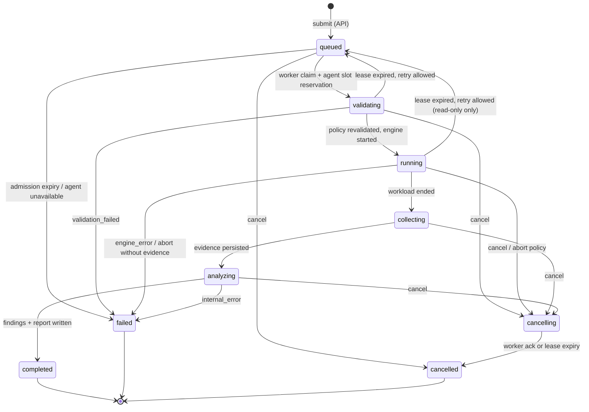
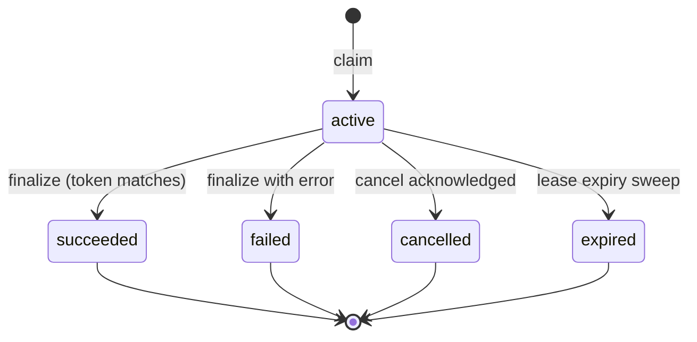

after# Run and attempt lifecycle

Status: Normative for states and evidence invariants; dispatch ownership and execution fencing below are Proposed (ADR-022).
Audience: backend implementers, coding agents, test authors
Related: FR-012, FR-032, NFR-001, invariants 3, 4, 8 in the [implementation blueprint](../architecture/implementation-blueprint.md#non-negotiable-invariants), [database schema](database-schema.md#lease-sql), [events](events-and-agent-protocol.md#sse-run-events), [error codes](error-codes.md#run-termination-reasons)

This is the single source of truth for run state. Other documents link here instead of restating it.

## Three independent dimensions

A run exposes three fields that must never be merged into one "status". The UI and reports present them separately (FR-043).

| Field | Values | Answers |
|---|---|---|
| `lifecycle` | `queued`, `validating`, `running`, `collecting`, `analyzing`, `completed`, `failed`, `cancelling`, `cancelled` | Where is the run in its execution? |
| `qualityStatus` | `null` (not yet known), `valid`, `inconclusive`, `invalid` | Can the evidence be trusted? |
| `outcome` | `null`, `pass`, `fail`, `warn` | Did thresholds and the comparison policy pass? Only meaningful when `qualityStatus = valid`. |

The **termination reason** (`terminationReason`) explains every terminal lifecycle. See [error codes](error-codes.md#run-termination-reasons).

## Run state machine

### Transition table

Every transition is a conditional SQL update. If it affects zero rows, the transition was not applied, and the caller must re-read state ([database schema](database-schema.md#lease-sql)).

| From | To | Trigger | Actor | Guard | Side effects |
|---|---|---|---|---|---|
| — | `queued` | `POST /api/v1/runs` | API | Schema, authz, target policy, effective limits, and quota admission all pass. Idempotency key not used with a different payload | Insert immutable run snapshot, audit event, `run.lifecycle` event (same transaction) |
| `queued` | `validating` | Claim | Server worker (Proposed ADR-022) | `FOR UPDATE SKIP LOCKED`; selected agent slot reserved; `notBefore <= now`; previous execution fenced | Create `run_attempt` with new ordinal, lease token, expiry |
| `queued` | `cancelled` | Cancel | API | `lifecycle = 'queued'` (this implies no active attempt, because claiming moves the run to `validating` atomically) | `terminationReason = user_cancelled`, `qualityStatus = null`, audit event, `run.terminal` SSE event |
| `queued` | `failed` | Admission timeout sweep | Worker housekeeping | Queued longer than `Worker:MaxQueueAge`, or (agent runs) the agent is offline longer than `Agent:DispatchTimeout` | `queue_timeout` or `agent_unavailable` |
| `validating` | `running` | Engine started | Lease owner | Agent policy revalidated; start authorization committed under worker lease; matching attempt/permit valid | Emit progress |
| `validating` | `failed` | Revalidation fails | Lease owner | Any check fails | `validation_failed`; no traffic sent |
| `running` | `collecting` | Engine exited after measurement window | Lease owner | Lease valid | Persist bounded progress |
| `running` | `failed` | Engine crashed before producing usable evidence | Lease owner | — | `engine_error`, `qualityStatus = invalid` |
| `collecting` | `analyzing` | Evidence and artifacts committed | Lease owner | Hashes verified | — |
| `analyzing` | `completed` | Checks, thresholds, report rendered | Lease owner | Lease valid | Set `qualityStatus`, `outcome`, report artifact |
| `analyzing` | `failed` | Unhandled analysis error | Lease owner | — | `internal_error`; evidence retained for re-analysis |
| non-terminal (except `queued`) | `cancelling` | Cancel request or automatic abort | API (user) / lease owner (abort) | — | Store `cancel_reason`, `cancel_requested_by`, and `cancel_requested_at` on the run; write an audit event; emit a `run.lifecycle` SSE event. For agent runs, the gateway sends a `cancel.request` agent message |
| `cancelling` | `cancelled` | Engine stopped and partial evidence persisted | Lease owner | — | `qualityStatus = inconclusive` if partial evidence exists, otherwise `null`; `terminationReason` copied from `cancel_reason` (`user_cancelled` or an `abort_*` reason) |
| `cancelling` | `cancelled` | Lease expired while cancelling | Housekeeping | Lease expired and executor stopped or its persisted stop bound passed (Proposed ADR-022; see [database schema](database-schema.md#lease-sql)) | `lease_expired_during_cancel` |
| `validating`/`running` | `queued` | Lease expired | Housekeeping | Scenario is approved read-only, attempts < `Worker:MaxAttempts`, and previous executor is confirmed stopped or its bounded stop deadline elapsed (Proposed ADR-022) | Attempt marked `expired`; new attempt later. **Samples never merge** (invariant 4) |
| `validating`/`running`/`collecting`/`analyzing` | `failed` | Lease expired, retry not allowed | Housekeeping | Mutation scenario, or attempts exhausted | `lease_lost` or `reconciliation_required` |

Rules:

- **Cancellation is idempotent.** Cancelling a `cancelling` or terminal run returns `202` with the current state and changes nothing.
- **Automatic aborts** (abort rules, caps, generator saturation) follow the same `cancelling` path, with an `abort_*` reason from the [termination-reason catalog](error-codes.md#run-termination-reasons).
- **Mutation runs** are rejected in the initial release (Proposed ADR-022). Future M3 mutation execution never returns to `queued` after `running` (invariant 8).
- **Terminal states are immutable.** Re-analysis creates a new report artifact version. It never changes the lifecycle.

## Attempt state machine

- Each attempt has its own `ordinal`, random 128-bit `lease_token`, artifact namespace (`runs/{runId}/attempts/{ordinal}/`), and metric rows.
- Heartbeat interval: `Worker:HeartbeatInterval` (default 10 s). Lease duration: `Worker:LeaseDuration` (default 30 s). A heartbeat that updates 0 rows means **lease lost**. Proposed ADR-022: the worker stops authorizing permits, and the agent must stop the engine within `K6:GracefulStop` + 5 s (the kill deadline in [k6 adapter → cancellation](k6-adapter.md#cancellation)), and neither may admit further evidence under the lost lease. Locally retained partial evidence remains isolated from later attempts.
- Only the current lease owner can finalize (invariant 3). Finalization of the attempt and the run happens in one transaction.

## Quality status rules

`qualityStatus` is computed once in `analyzing` by a versioned `QualityPolicy` ([metrics and statistics](metrics-and-statistics.md#generator-validity-and-quality-status)):

- `invalid`: the measurement is known wrong. Examples: engine crash mid-window, generator dropped >10% of offered iterations, attempt evidence incomplete.
- `inconclusive`: the measurement is technically fine but cannot support a conclusion. Examples: inadequate samples for a gated percentile, generator CPU saturated, required telemetry missing for a gated check, cancelled.
- `valid`: none of the above.

Only `valid` runs can produce `outcome = pass|fail|warn` or become baselines (US-011).

## Execution location

`executionLocation ∈ {server_worker, local_agent, diagnostic_tunnel}` is fixed at submission. It determines the supported execution path. Proposed (ADR-022): only `local_agent` is admitted initially. The server worker claims and owns its lease; the selected agent is its executor, not a database lease owner. Reserved `server_worker`/`diagnostic_tunnel` values are rejected at admission until separately implemented.

## Required tests

These are integration tests with Testcontainers PostgreSQL:

- two workers racing to claim the same run
- heartbeat after expiry
- finalize with a stale token
- cancel racing with completion
- cancel while queued
- expiry with retry allowed vs mutation
- attempt-2 evidence never including attempt-1 samples
- idempotent cancel
- terminal-state immutability

## Agent dispatch and stop fencing — Proposed (ADR-022)

The worker owns one lease from `validating` through `analyzing`; it never transfers lease ownership to the gateway or agent. An agent report is an input to a guarded transition, not authority to advance state. Worker lease tokens stay server-side. Agent messages instead bind project, agent, run, attempt, ordinal, and the current dispatch ID; the server verifies these against durable state.

Claim creates the attempt **before** manifest offer. Persist the dispatch and selected agent slot in the claim transaction; no other attempt can use that slot. On `manifest.accept`, the worker commits `start_authorized_at` and an `execution_permit_until` under its unexpired lease and matching dispatch. The gateway sends `attempt.start` only from that committed record. The agent journals the start authorization before launching k6. Duplicate offer/start and reconnect cannot launch another process. A rejected/expired offer fails the attempt; it cannot silently select another agent.

Manifest `exp` bounds acceptance/start authorization, not an already accepted run's entire workload duration. A separate signed `executionDeadline` bounds the latest local process stop. Renewable permits cannot extend beyond that deadline or the server lease. Convert received validity to a conservative monotonic local countdown using server-time offset/uncertainty; never extend authority because the local wall clock moves backwards. Refuse execution when clock uncertainty exceeds the configured allowance.

The agent emits execution heartbeats separately from lossy progress. While traffic is active, the worker renews its lease only with a fresh authenticated heartbeat from that dispatch. The gateway never renews a lease on its own. During collecting/analyzing after confirmed engine stop, the worker can renew while performing server work. A permit is invalid when the worker lease is lost even if the control socket is still open.

On user cancellation, revocation, local abort, expired permit, signed deadline, or control loss beyond grace, the agent stops new work and terminates the process tree within the [k6 stop budget](k6-adapter.md#cancellation). Its latest possible stop is the earlier of the signed deadline and last valid permit plus stop budget, with conservative clock uncertainty. Persist the maximum outstanding stop bound before sending a permit. A new attempt may start only after a matching stop acknowledgment or that bound has passed. Lease expiry alone does not establish that traffic stopped. Agent restart kills/reconciles any surviving process and never replays a journaled start.

Cancellation remains `cancelling` until stop/evidence processing is acknowledged or the fenced expiry sweep can safely conclude. All progress, artifact grants/admission, transitions, and finalization check current attempt and expiry. In `collecting`/`analyzing`, lease loss fails with `lease_lost` and retains admitted evidence; it does not start more target traffic. Optional AI jobs never delay terminalization or change terminal run state.

Required integration tests additionally cover a live gateway with a dead worker, delayed start after lease expiry, stale permit renewal, local clock rollback, restart after start journal commit, duplicate dispatch across reconnect, retry before old-process stop, cancellation during upload/analysis, and late uploads/results from an expired attempt.
